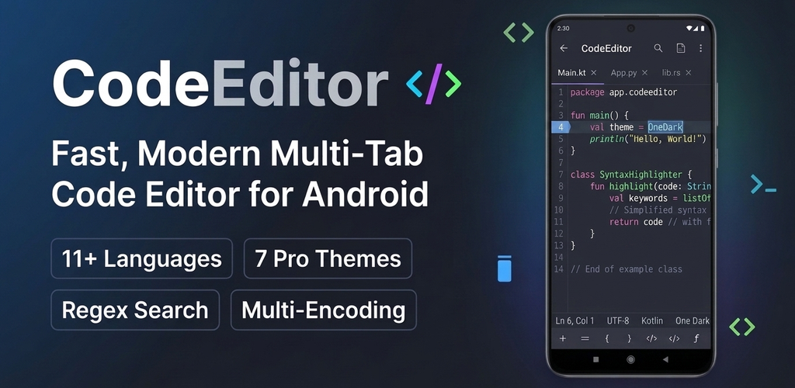

# CodeEditor

<p align="center">
  
</p>

<p align="center">
  <strong>A modern, fast, and privacy-focused text and code editor for Android built with Jetpack Compose & Material 3.</strong>
</p>

<p align="center">
  
  
  
  
  
  
</p>

---

## 📖 Overview

**CodeEditor** is an open-source, full-featured text and source code editor developed specifically for Android devices. Designed with an offline-first and privacy-centric approach, CodeEditor provides developers, students, and system administrators with a lightweight IDE experience directly on smartphones, foldables, and tablets.

Powered by **Jetpack Compose** and **Material 3**, CodeEditor combines fluent 120Hz smooth rendering, non-destructive syntax highlighting, versatile character encoding support, and robust document management via Android's Storage Access Framework (SAF).

---

## ✨ Key Features

### 🎨 Multi-Language Syntax Highlighting
Fast, non-destructive regex-based syntax token scanner utilizing Compose `VisualTransformation`. Your underlying text remains clean and unmutated while rendering rich typography and keyword colors.
- **Languages Supported**: C / C++, Python, Rust, Java, Kotlin, JavaScript, TypeScript, HTML, JSON, Markdown, and SQL.
- **Language Switcher**: Automatic file-extension detection with manual override available on the fly.

### 📑 Multi-Tab Workspace
- Open multiple files at once and switch tabs seamlessly.
- Active modification indicator (`*`) for unsaved buffers.
- Create new scratch files with language-specific boilerplates and templates.

### 🔍 Search & Replace Engine
- **Flexible Search**: Regular expressions (Regex), whole-word matching, and case-sensitivity toggle.
- **Match Navigation**: Real-time match counter (`Match X of Y`) with forward and backward jumping.
- **Replacement Controls**: In-place single match replace or atomic replace-all.

### 🌐 Universal Character Encodings & BOM Handling
- Automatic Byte Order Mark (BOM) detection (UTF-8 BOM, UTF-16 LE, UTF-16 BE).
- Read, transcode, and save documents across legacy and international character sets:
  - **UTF-8**, **UTF-16LE**, **UTF-16BE**, **US-ASCII**, **ISO-8859-1 (Latin-1)**
  - **Windows-1252**, **GBK / GB2312** (Simplified Chinese), **Big5** (Traditional Chinese)
  - **Shift_JIS / EUC-JP** (Japanese), **EUC-KR** (Korean)

### 🌓 Beautiful Designer Color Themes
Custom-crafted dark and light color schemes tuned for high readability:
- **Dark Themes**: One Dark (default), Dracula, Monokai Pro, Nord, Solarized Dark
- **Light Themes**: GitHub Light, Solarized Light

### ⌨️ Coding Symbol Accessory Bar
- Quick-insert bar docked right above the soft keyboard:
  `{`, `}`, `(`, `)`, `[`, `]`, `<`, `>`, `;`, `"`, `'`, `=`, `+`, `-`, `*`, `/`, `&`, `|`, `!`, `?`, `\t` (Tab).
- Dedicated Undo / Redo controls.

### 🛡️ Storage Access Framework (SAF) & Scoped Storage
- Modern Android scoped storage integration (`OpenMultipleDocuments`, `CreateDocument`).
- **No invasive permissions**: Does not require broad storage access (`MANAGE_EXTERNAL_STORAGE` or `READ_EXTERNAL_STORAGE`).
- Directly open files from Google Drive, Nextcloud, SD cards, or device storage.

### 👓 Readability & Typography
- Independent **Font Size** scaling (increase/decrease on demand).
- Toggleable **Word Wrap** mode for prose and code.
- Sticky line number gutter with automatic zero-padding.

---

## 📸 Screenshots

| Initial View | Rust Highlighting | Search & Replace |
| :---: | :---: | :---: |
|  |  |  |

| Dracula Theme | GitHub Light Theme | New File Dialog |
| :---: | :---: | :---: |
|  |  |  |

| Theme Selector | Language Dialog | Encoding Selector |
| :---: | :---: | :---: |
|  |  |  |

---

## 🗂️ Supported Languages & Extensions

| Language | Badge | Associated File Extensions |
| :--- | :---: | :--- |
| **C / C++** | `C++` | `.cpp`, `.c`, `.h`, `.hpp`, `.cc`, `.cxx` |
| **Python** | `Py` | `.py`, `.pyw` |
| **Rust** | `Rs` | `.rs` |
| **Java** | `Jv` | `.java` |
| **Kotlin** | `Kt` | `.kt`, `.kts` |
| **JavaScript** | `JS` | `.js`, `.jsx`, `.mjs` |
| **TypeScript** | `TS` | `.ts`, `.tsx` |
| **HTML** | `HTML` | `.html`, `.htm` |
| **JSON** | `JSON` | `.json` |
| **Markdown** | `MD` | `.md`, `.markdown` |
| **SQL** | `SQL` | `.sql` |
| **Plain Text** | `TXT` | `.txt`, `.log`, all unrecognized files |

---

## 🏛️ Architecture & Tech Stack

CodeEditor is built adhering to Google's recommended Modern Android Architecture principles:

- **Pattern**: MVVM with Unidirectional Data Flow (UDF) powered by `StateFlow`.
- **Pure Core Logic**: Core syntax highlighting, search/replace, and encoding engines are strictly decoupled from Android framework dependencies, enabling lightning-fast host JVM testing.
- **UI Toolkit**: 100% Jetpack Compose with Material 3 design tokens.
- **State Management**: Reactive and immutable data models (`EditorTab`, `SearchState`, `EditorTheme`).

```
app/src/main/java/app/kiddos/codeeditor/
├── MainActivity.kt         # Edge-to-edge Compose activity
├── data/                   # Models, themes, charsets, starter templates
│   ├── EditorTab.kt        # Tab buffer model & undo/redo tracking
│   ├── EditorTheme.kt      # Color palettes & theme definitions
│   ├── EncodingHelper.kt   # Charset conversion & BOM detection
│   ├── ProgrammingLanguage.kt # Supported languages & badge mappings
│   └── SampleCodes.kt      # Default templates for new files
├── search/                 # Search & replace engine
│   └── SearchState.kt      # Regex matching, navigation, replacement logic
├── syntax/                 # Syntax highlighting engine
│   ├── LanguageRules.kt    # Keyword and type definitions
│   └── SyntaxHighlighter.kt# VisualTransformation token scanner
└── ui/                     # Jetpack Compose UI layer
    ├── EditorViewModel.kt  # Central ViewModel & atomic state updates
    ├── MainScreen.kt       # Root scaffold, top app bar, SAF launchers
    ├── components/         # Gutter editor, status bar, tabs, dialogs
    └── theme/              # Material 3 theme & typography definitions
```

---

## 🛠️ Build & Installation

### Prerequisites
- **JDK**: Java 17 or Java 21
- **Android SDK**: Compile SDK `36`, Build Tools `36.0.0`
- **Gradle**: 9.3.1 (configured via `./gradlew`)

### Build Commands

```bash
# Clone the repository
git clone https://github.com/kiddos/CodeEditor.git
cd CodeEditor

# Build Debug APK
./gradlew assembleDebug

# Build Release APK
./gradlew assembleRelease

# Run host JVM unit tests
./gradlew testDebugUnitTest

# Run code style & lint checks
./gradlew lintDebug
```

The compiled APK will be generated at:
`app/build/outputs/apk/debug/app-debug.apk`

### Install onto Device / Emulator

```bash
# Install directly via Gradle
./gradlew installDebug

# Or using ADB directly
adb install -r app/build/outputs/apk/debug/app-debug.apk
```

---

## 🔒 Privacy & Permissions

CodeEditor is built with **Privacy by Design**:
- **Offline First**: All parsing, syntax highlighting, search/replace, and file saves occur strictly on your local device.
- **Zero Telemetry**: No tracking, user profiling, or background analytics.
- **Scoped Storage**: No access to your files without your explicit document selection via the system picker.

For complete details, please see our [Privacy Policy](POLICY.md).

---

## 🤝 Contributing

Contributions, bug reports, and feature proposals are welcome!
1. Check the open issues or file a new one describing your bug or idea.
2. Fork the repository and create your feature branch: `git checkout -b feature/my-feature`.
3. Verify that all unit tests pass: `./gradlew testDebugUnitTest`.
4. Submit a pull request.

Please review [AGENTS.md](AGENTS.md) for detailed architecture guidelines, coding conventions, and developer references.

---

## 📄 License

```
Copyright 2026 CodeEditor Contributors

Licensed under the Apache License, Version 2.0 (the "License");
you may not use this file except in compliance with the License.
You may obtain a copy of the License at

    http://www.apache.org/licenses/LICENSE-2.0

Unless required by applicable law or agreed to in writing, software
distributed under the License is distributed on an "AS IS" BASIS,
WITHOUT WARRANTIES OR CONDITIONS OF ANY KIND, either express or implied.
See the License for the specific language governing permissions and
limitations under the License.
```
